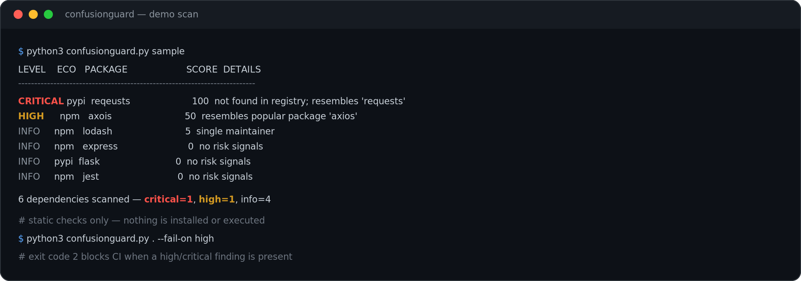
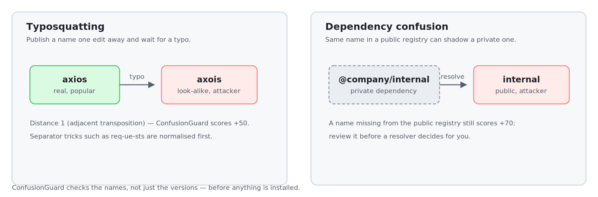
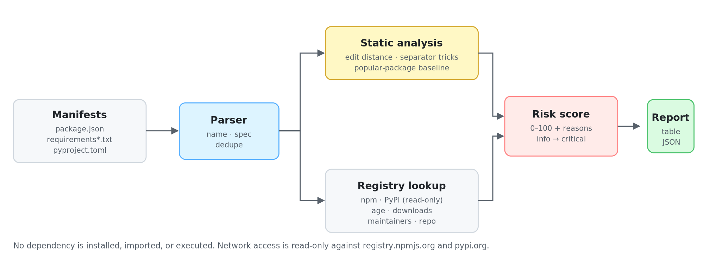

# ConfusionGuard

[](https://github.com/ovulndeveloper/confusionguard/actions/workflows/tests.yml)


**A dependency-confusion and typosquat risk scanner for npm and PyPI manifests.**

Most scanners look for known CVEs. ConfusionGuard checks the **names** — because
a dependency you think is `axios` but is actually `axois` is a supply-chain
compromise waiting to happen.



```bash
python3 confusionguard.py /path/to/repo --fail-on high
```

---

## Contents

- [Why this exists](#why-this-exists)
- [What it works on](#what-it-works-on)
- [Visual overview](#visual-overview)
- [What it checks](#what-it-checks)
- [Risk levels](#risk-levels)
- [Install](#install)
- [Usage](#usage)
- [Output formats](#output-formats)
- [CI integration](#ci-integration)
- [How it works](#how-it-works)
- [Project structure](#project-structure)
- [Testing](#testing)
- [Limitations](#limitations)
- [Safety](#safety)
- [Roadmap](#roadmap)
- [License](#license)

---

## Why this exists

Two attacks are cheap, common, and easy to miss:

**Typosquatting** — publish a package one character away from a popular one
(`axois`, `reqeusts`, `lodahs`) and wait for a typo. Your lockfile records the
fake package, your build installs it, and attacker code runs with your CI
credentials.

**Dependency confusion** — publish a *public* package that has the same name as
your *private* dependency. Depending on resolver order, the public one can win.



ConfusionGuard looks for both patterns **before** anything is installed.

## What it works on

| Ecosystem | Manifests | Registry data used |
| --- | --- | --- |
| **npm** | `package.json` → `dependencies`, `devDependencies`, `optionalDependencies`, `peerDependencies`; scoped names (`@scope/pkg`) | `registry.npmjs.org` (existence, age, maintainers, repo), `api.npmjs.org` (weekly downloads) |
| **PyPI** | `requirements.txt`, `requirements-*.txt`, `pyproject.toml` (PEP 621 `[project]`, optional groups, Poetry) | `pypi.org` (existence, first release date, project URLs/version) |

Works as a **CLI** and as a **library** (`import confusionguard`). No dependencies
beyond the Python standard library. Python **3.11+** (`tomllib`).

## Visual overview



1. **Parse** the manifests into `(ecosystem, name, spec)` tuples and dedupe.
2. **Static analysis** — compare each name with a built-in popular-package
   baseline using edit distance and separator tricks; never flag exact matches.
3. **Registry lookup** — ask npm/PyPI whether the package exists, how old it is,
   how popular it is, and whether it links a repository.
4. **Score** every signal into 0–100 with human-readable reasons.
5. **Report** as a table or JSON, with an exit code you can gate CI on.

## What it checks

| Signal | Weight | Why it matters |
| --- | ---: | --- |
| Package not found in the public registry | **+70** | Classic dependency-confusion setup |
| Name is one edit from a popular package | **+50** | Typosquat / look-alike |
| Published less than 90 days ago | **+25** | Fresh impersonation accounts |
| Published less than one year ago | **+10** | Lower confidence, still notable |
| Fewer than 100 downloads/week (npm) | **+15** | Unused package impersonating a real one |
| Single maintainer (npm) | **+5** | Weak account, easier to take over |
| No repository or homepage linked | **+5** | Throwaway package |

Scores are capped at 100. Each finding keeps the **reasons** that produced it, so
you can triage instead of trusting a black-box number.

### Detection examples

| Name | Ecosystem | Verdict | Why |
| --- | --- | --- | --- |
| `axios` | npm | clean | exact popular match |
| `axois` | npm | high | adjacent transposition of `axios` |
| `express-session` | npm | clean | legitimate plugin, not a look-alike |
| `req-ue-sts` | PyPI | high | separator trick → `requests` |
| `internal-billing` | PyPI | critical if missing | possible dependency confusion |

## Risk levels

| Level | Score | Meaning | Typical action |
| --- | --- | --- | --- |
| `info` | 0–9 | No strong signals | none |
| `low` | 10–24 | Minor concerns | review |
| `medium` | 25–44 | Multiple weak signals | verify before merge |
| `high` | 45–69 | Look-alike or suspicious metadata | block / investigate |
| `critical` | 70–100 | Likely confusion or impersonation | block |

```bash
python3 confusionguard.py . --fail-on high   # exit 2 on high or critical
```

## Install

No dependencies. Python 3.11+.

```bash
git clone https://github.com/ovulndeveloper/confusionguard.git
cd confusionguard
python3 confusionguard.py --help
```

Optional — put it on your `PATH`:

```bash
install -m 0755 confusionguard.py ~/.local/bin/confusionguard
confusionguard /path/to/repo
```

## Usage

```bash
# scan a repository directory (package.json, requirements.txt, pyproject.toml)
python3 confusionguard.py /path/to/repo

# scan a single manifest
python3 confusionguard.py ./package.json
python3 confusionguard.py ./requirements-dev.txt

# static checks only — no network requests
python3 confusionguard.py . --offline

# machine-readable output
python3 confusionguard.py . --json

# fail CI at a threshold
python3 confusionguard.py . --fail-on high
```

| Flag | Default | Description |
| --- | --- | --- |
| `path` | — | Repository directory or manifest file |
| `--json` | off | Emit JSON instead of a table |
| `--offline` | off | Static checks only, no registry requests |
| `--timeout N` | `8` | Per-request timeout in seconds |
| `--fail-on LEVEL` | `none` | Exit `2` when a finding reaches `low`/`medium`/`high`/`critical` |

Exit codes: `0` clean or below threshold · `1` bad input · `2` finding at or above `--fail-on`.

## Output formats

### Table

```
LEVEL    ECO   PACKAGE                     SCORE  DETAILS
---------------------------------------------------------
CRITICAL pypi  reqeusts                      100  not found in public registry (dependency-confusion risk); name resembles popular package 'requests'
HIGH     npm   axois                          50  name resembles popular package 'axios'
INFO     npm   express                         0  no risk signals

3 dependencies scanned — critical=1, high=1, info=1
```

### JSON (`--json`, offline scan)

```json
[
  {
    "ecosystem": "pypi",
    "name": "reqeusts",
    "spec": "==2.31.0",
    "level": "high",
    "score": 50,
    "reasons": ["name resembles popular package 'requests'"],
    "latest": null,
    "source": "sample/requirements.txt"
  }
]
```

## CI integration

The repository already runs its own tests in `.github/workflows/tests.yml`.
Add a dependency check to any project:

```yaml
name: supply-chain

on: [push, pull_request]

jobs:
  confusionguard:
    runs-on: ubuntu-latest
    steps:
      - uses: actions/checkout@v4
      - uses: actions/setup-python@v5
        with:
          python-version: "3.12"
      - name: Scan dependencies
        run: |
          git clone --depth 1 https://github.com/ovulndeveloper/confusionguard.git /tmp/cg
          python3 /tmp/cg/confusionguard.py . --fail-on high
```

## How it works

```
manifests ──▶ parse ──┬──▶ static analysis (edit distance, separators, popular list)
                      └──▶ registry lookup  (existence, age, downloads, maintainers, repo)
                                       │
                                       ▼
                             risk score 0–100 + reasons
                                       │
                                       ▼
                              table / JSON / exit code
```

- **Edit distance** uses optimal string alignment (Levenshtein plus adjacent
  transpositions), so `axois` → `axios` is caught with distance 1.
- **Separator tricks** normalise `-`, `_`, and `.` so `req-ue-sts` → `requests`.
- **Exact matches are never flagged** — `axios` and `@types/express` stay clean.
- **Legitimate plugins are not flagged** — `express-session` is far from `express`.
- **Registry failures are not false positives** — a network error is reported as
  "lookup failed", not "package missing".

No dependency is installed, imported, or executed. Network access is read-only
(`registry.npmjs.org`, `api.npmjs.org`, `pypi.org`).

## Project structure

```
confusionguard/
├── confusionguard.py            # CLI + library (single file, stdlib only)
├── tests/
│   └── test_confusionguard.py   # 22 unit tests
├── sample/
│   ├── package.json             # demo manifest (do not install)
│   └── requirements.txt
├── assets/                      # PNG for universal rendering + SVG source
│   ├── demo.png / demo.svg
│   ├── how-it-works.png / how-it-works.svg
│   └── attack-models.png / attack-models.svg
├── .github/workflows/tests.yml  # CI: Python 3.11, 3.12, 3.13
├── README.md
└── LICENSE
```

## Testing

```bash
python3 -m unittest discover -s tests -v
```

The suite covers distance/typosquat detection, separator tricks, manifest
parsing (requirements, package.json, pyproject), scoring boundaries, lookup
failure handling, offline scanning, JSON output, and the CI exit code.

## Limitations

- **Heuristics, not proof.** A flagged name can be legitimate — review it.
- **Private packages are expected to be missing publicly.** Use `--offline`, or
  treat "not found" as informational for known-internal names.
- **PyPI has no weekly-download signal**, so npm-only signals are skipped there.
- The **popular-package baseline is curated**. Extend `POPULAR` for your stack.
- **Not a replacement** for lockfiles, provenance attestations, or a full SBOM
  scanner — use it alongside them.
- The baseline is case-insensitive; npm names are lowercase in practice.

## Safety

ConfusionGuard is **defensive tooling**. It reads manifests, performs read-only
registry requests, and reports risk. It does not install, execute, or modify
dependencies, and it includes no exploit code.

## Roadmap

- [ ] SARIF output for GitHub code scanning
- [ ] Lockfile scanning (`package-lock.json`, `poetry.lock`, `requirements.lock`)
- [ ] Per-project allowlist / ignore file
- [ ] Local metadata cache to reduce registry calls
- [ ] Go modules and Cargo crates
- [ ] Reusable GitHub Action

## License

MIT — see [LICENSE](LICENSE).
